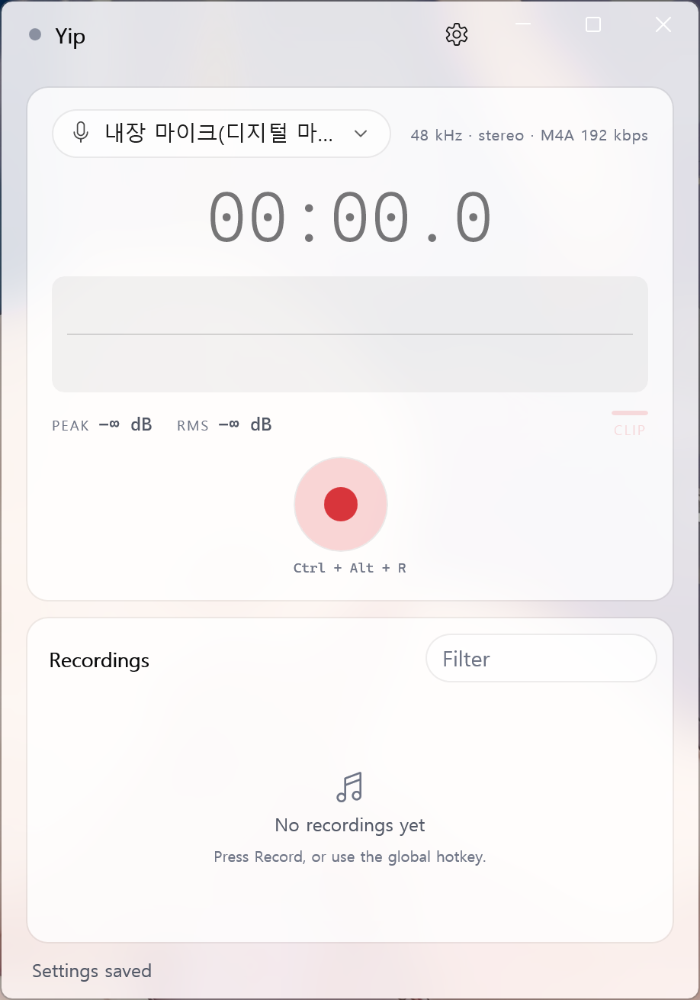
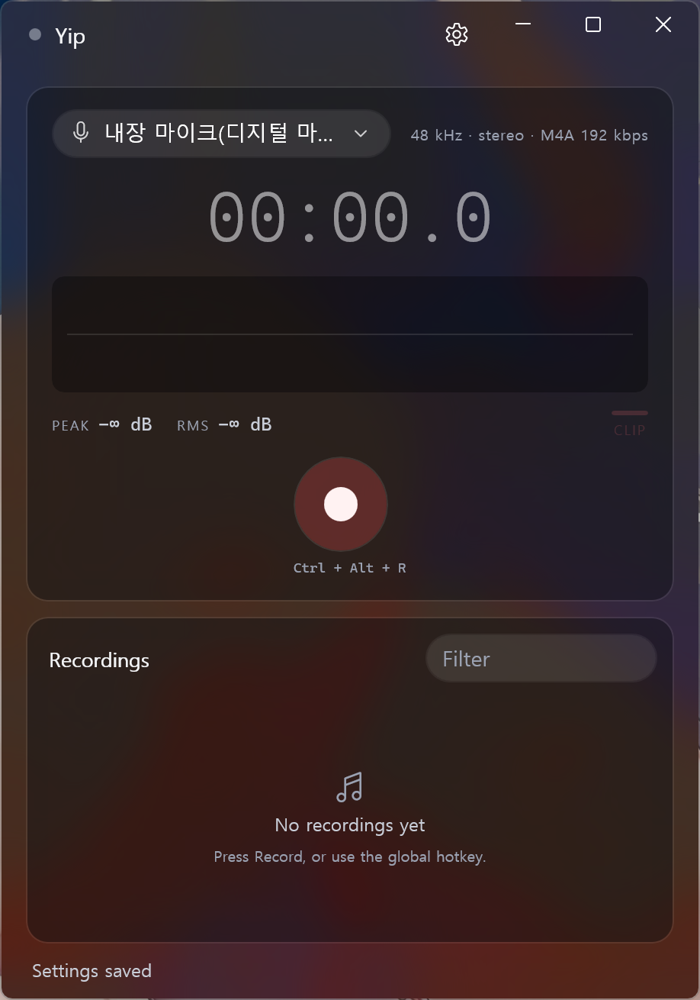
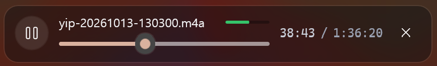
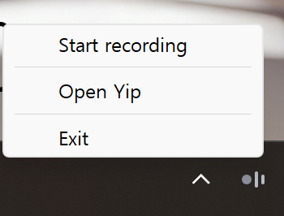

<!--
  Media lives in docs/media/. Drop files in with these exact names and the
  README picks them up:

    hero-light.png   main window, light theme   (~1600 px wide)
    hero-dark.png    main window, dark theme    (same size as hero-light)
    pill-dot.png     the pill in dot style
    playback.png     transport strip under the list, a take playing
    settings.png     Settings dialog (formats, hotkey, folder)
    tray.png         notification-area icon and its menu
-->

<div align="center">

# Yip

**A small, fast audio recorder for Windows.**<br>
Press a hotkey, talk, press it again.

[](https://github.com/Fury7425/Yip/actions/workflows/ci.yml)
[](https://github.com/Fury7425/Yip/releases/latest)
[](LICENSE)


[**Download**](https://github.com/Fury7425/Yip/releases/latest) ·
[Website](https://fury7425.github.io/Yip/) ·
[Build from source](#build-from-source)

<picture>
  
  
</picture>

</div>

Yip is built from native parts only: WinUI 3 on top, Rust and WASAPI
underneath. Its capture path never allocates, locks or blocks.

No AI, no cloud, no telemetry. Yip makes no network calls at all.

## How to use it

1. Press `Ctrl+Alt+R` from any app. The pill drops in from the edge of the screen.
2. Talk. The pill shows the recording light, elapsed time and a live meter.
3. Press `Ctrl+Alt+R` again. The take lands in `Music\Yip`, ready to play.

## Features

### Recording pill

A small indicator at the top or bottom of the screen. Tap it and Pause and
Stop bud off its end. It lets clicks pass through, and it can shrink to a
single dot that holds just the recording light.

<p align="center">
  
</p>

### Built-in playback

<p align="center">
  
</p>

Click a recording to play it. The transport has play/pause, a scrubber and a
level meter, and seeking while you drag stays smooth. The same lock-free
engine as capture runs it in reverse.

### Four formats, no extra encoders

<p align="center">
  
</p>

| Format | Settings                    | Good for |
|--------|-----------------------------|----------|
| WAV    | 16 · 24-bit · 32-bit float  | Editing later. Long takes roll over into a new part before the 4 GB limit. |
| FLAC   | 16 · 24-bit                 | Lossless at about half the size. |
| MP3    | 128–320 kbps                | Sending to anyone, playing anywhere. |
| M4A    | AAC · 96–192 kbps           | Small files for voice notes. |

Every encoder ships with Windows, so Yip bundles none of its own.

### Lives in the tray

<p align="center">
  
</p>

Closing the window keeps Yip running at 0% CPU, with the window's memory
handed back. Recording and the hotkey keep working, and the tray icon or
relaunching the exe brings the window back where you left it. Only one copy
of Yip runs at a time.

### And also

- **Pause without gaps.** A paused take keeps the device stream open, so
  resuming is instant and the clock doesn't count the paused time.
- **Metering you can trust.** A logarithmic meter with peak hold, a clip
  lamp, and counters for overruns and dropped frames.
- **Feels like part of Windows.** Mica and acrylic backgrounds, light and
  dark themes, keyboard shortcuts throughout.

## Yip vs. Sound Recorder

Windows already ships a recorder, and it is a fine app to open and use. Yip
is built for recording without leaving what you were doing.

|                | Yip | Sound Recorder |
|----------------|-----|----------------|
| Start a take   | `Ctrl+Alt+R` from any app | Open the app, click Record |
| While you work | A small pill stays on top with time, level, Pause and Stop | Status lives in its own window |
| Between takes  | Waits in the tray at 0% CPU | Not running until you open it |
| Quality        | Exact bit depth (16 / 24 / 32-bit float) or bitrate | Auto, Best, High or Medium presets |
| Meter          | Log scale, peak hold, clip lamp, dropped-frame count | Live waveform |
| Markers        | None | Yes, during recording |

## Keyboard shortcuts

| Keys          | Action |
|---------------|--------|
| `Ctrl+Alt+R`  | Start / stop recording (works from any app, rebindable) |
| `Ctrl+R`      | Start / stop recording (in the window) |
| `Ctrl+P`      | Play / pause the selected recording |
| `Ctrl+F`      | Search recordings |
| `F5`          | Refresh the recordings list |

## Install

Download `yip-setup-<version>-x64.exe` (or `-arm64.exe`) from the
[latest release](https://github.com/Fury7425/Yip/releases/latest) and run it.
It installs for the current user only, so no admin prompt appears. Yip is
self-contained, so you don't need the Windows App SDK runtime.

> [!NOTE]
> **Defender or SmartScreen may block the installer.** The build is unsigned
> and new, so it has no download reputation yet.
> [installer/README.md](installer/README.md) explains why and what to do.

**Requirements:** Windows 10 2004 (build 19041) or later. Windows 11 x64 is
the main target, and ARM64 is also supported. The *N* and *KN* editions of
Windows can only record WAV unless the
[Media Feature Pack](https://support.microsoft.com/windows/media-feature-pack-list-for-windows-n-editions-c1c6fffa-d052-8338-7a79-a4bb980a700a)
is installed.

| What        | Location |
|-------------|----------|
| Recordings  | `%USERPROFILE%\Music\Yip` (change it in Settings) |
| Settings    | `%LOCALAPPDATA%\Yip\settings.json` |

Uninstalling leaves both of these in place.

## Build from source

<details>
<summary><b>Prerequisites, build, installer and checks</b></summary>

### Prerequisites

- **Visual Studio 2022** with the *Desktop development with C++* workload and
  the **Windows 11 SDK 10.0.22621+**
- **Rust** stable 1.85+ via [rustup](https://rustup.rs). `rust-toolchain.toml`
  pins it. Add `aarch64-pc-windows-msvc` if you want the ARM64 build.
- **CMake** 3.27+
- *(optional)* [Inno Setup 6](https://jrsoftware.org/isinfo.php) (`iscc` on
  `PATH`) to build the installer

NuGet restores the Windows App SDK and C++/WinRT packages during the build.

### Build

```powershell
cmake --preset release
cmake --build --preset release
```

This produces `build/release/yip-app/Release/yip-app.exe`, a self-contained
app you can run directly.

| Preset          | Output |
|-----------------|--------|
| `debug`         | x64 debug build |
| `release`       | x64 release build |
| `release-arm64` | ARM64 release, cross-compiled on x64 |

### Installer

```powershell
iscc /DYipSourceDir=..\build\release\yip-app\Release /DYipVersion=1.0.0 installer\yip.iss
```

The installer is written to `installer/out/yip-setup-<version>-<arch>.exe`.

### Checks

These are the same gates CI runs:

```powershell
cargo fmt --check
cargo clippy --all-targets --all-features -- -D warnings
cargo test --release
```

</details>

## How it works

```
┌──────────────────────────────┐
│ yip-app  (WinUI 3, C++/WinRT)│  MainWindow · pill · tray · hotkey · settings
└──────────────┬───────────────┘
               │  plain C ABI (audio_core.h, generated by cbindgen)
┌──────────────▼───────────────┐
│ audio-core  (Rust staticlib) │
│                              │
│  capture ─▶ SPSC ring ─▶ writer ─▶ WAV (hound) / FLAC·MP3·M4A (Media Foundation)
│  render  ◀─ SPSC ring ◀─ decoder ◀─ Media Foundation source reader
└──────────────┬───────────────┘
               │
            WASAPI (event-driven, MMCSS "Pro Audio")
```

- **The realtime threads don't allocate, lock, block or log.** Capture and
  render talk to the file side through a lock-free `rtrb` ring buffer and
  atomics, and nothing else.
- **The UI never waits on audio.** Meter and playback state come back from a
  single lock-free snapshot call (`rec_meter` / `play_state`). Recording start
  and stop are pushed to the UI through a callback, so no timers run while
  idle.
- **Errors show up early.** A format the encoder refuses fails at
  `rec_start`, and a file that can't be played fails at `play_start`. You
  never get a silent take or silent playback.
- **Nothing but plain C crosses the FFI boundary.** Every Rust entry point
  catches panics, checks for null and validates UTF-8.

| Directory     | Language             | Builds |
|---------------|----------------------|--------|
| `audio-core/` | Rust 2024            | `audio_core.lib` (staticlib) |
| `yip-app/`    | C++20 / WinRT / XAML | `yip-app.exe` (unpackaged) |
| `installer/`  | Inno Setup           | `yip-setup-*.exe` |

[CLAUDE.md](CLAUDE.md) covers the full architecture rules, conventions and
design-token system. [GitHub Actions](.github/workflows/ci.yml) builds x64,
ARM64 and the installers on every push and pull request.

## Status

| Milestone | Status |
|-----------|--------|
| M1–M3: FFI skeleton, WASAPI capture, main window | ✅ Done |
| M4: recording indicator pill | ✅ Done |
| M5–M6: VST3 processing | ⏸ Removed for now |
| M7: polish (hotkey, tray, formats, playback, installer, ARM64) | ⏳ Nearly done: clippy sweep, clang-format gate, WPR profiling left |

## License

[MIT](LICENSE) © 2026 Yip contributors.
